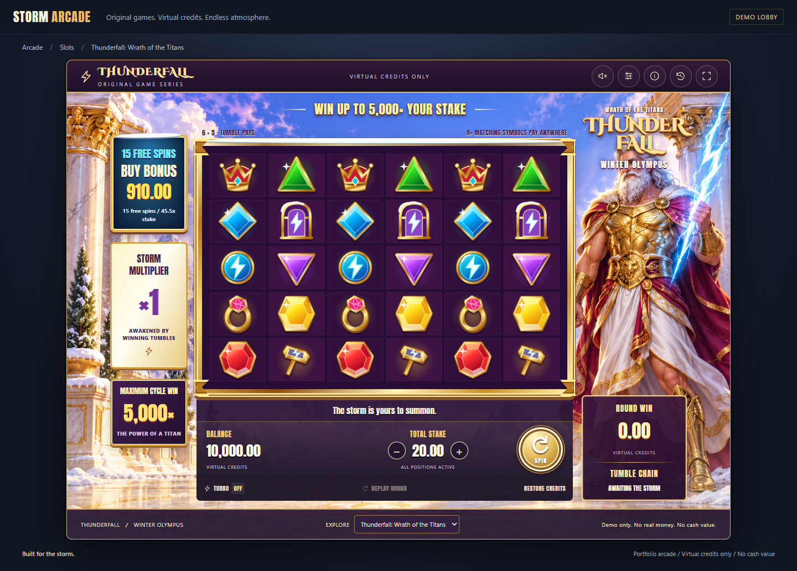

# Thunderfall

**A storm-themed slot game with cascading wins, persistent bonus multipliers, and a deterministic .NET engine.**

Thunderfall combines a playable React/PixiJS client with versioned game mathematics, transactional wallet settlement, replayable rounds, and a reproducible Monte Carlo simulator. Two games share the same engine and platform: the flagship 6х5 cascade game and a classic 5х3 payline slot.



[Quick start](#quick-start) ? [Gameplay](#gameplay) ? [Algorithms](#algorithms-and-mathematics) ? [Architecture](#architecture) ? [Verification](#verification) ? [Documentation](#documentation)

> A portfolio demo using virtual credits. No real-money payments or gambling certification.

## Gameplay

### Thunderfall ? cascades and Storm Orbs

A spin clears the previous board, then drops new symbols into six columns. **Eight or more matching ordinary symbols anywhere on the board** create a win; adjacency and paylines are not required. Winning symbols disappear together, survivors fall into the gaps, and new symbols enter from above. The process continues until no further win is found.

| Mechanic | Rule |
|---|---|
| Board | 6 columns ? 5 rows |
| Paying symbols | Eight categories, with payout bands at 8?9, 10?11, and 12+ matches |
| Storm Orbs | Values from ?2 to ?500; collected on a winning board, once per physical orb |
| Free spins | 4+ ThunderGates on the initial paid board award 15 spins |
| Retriggers | 3+ ThunderGates on an initial free-spin board award 5 more spins |
| Bonus multiplier | Starts at ?1 and accumulates collected orb values across free spins |
| Bonus Buy | 15 free spins for 45.5? the selected stake; the purchase plays the first spin immediately |
| Cycle maximum | 5,000? the original stake across the complete paid cycle |

In the base game, collected orb values are summed into the round multiplier, with ?1 used when none are collected. During free spins, new orb values increase the persistent bonus multiplier before settlement. The cap includes the triggering paid round and all resulting free spins and retriggers. For Bonus Buy, it remains based on the ordinary stake, not the purchase price.

### Classic ? reels, paylines, and Wilds

The second module uses a **5?3 board**, cyclic reel strips, five fixed paylines, and best-paying Wild substitution. It shares sessions, wallet accounting, history, replay, simulation, and rendering with Thunderfall, demonstrating how another game fits into the platform.

### Player experience

- Responsive winter-temple interface with original symbols, self-hosted fonts, and procedural Web Audio.
- Normal and turbo playback, animation skipping, reduced-motion support, and fullscreen controls.
- Paginated round history and read-only replay, including rounds from the other game.
- Persistent free-spin state that resumes after reload or an API restart.
- Retry handling for interrupted requests without charging the same operation twice.

## Technology stack

| Area | Technologies |
|---|---|
| Backend | C#, .NET 10, ASP.NET Core, OpenAPI |
| Persistence | PostgreSQL 16, Entity Framework Core 10, Npgsql |
| Frontend | React 19, TypeScript, Vite 7 |
| Rendering and audio | PixiJS 8, GSAP 3, Web Audio API |
| Mathematical verification | xUnit, FsCheck, exact probability checks, deterministic simulation |
| UI verification | Vitest, Testing Library, Playwright |
| Performance | BenchmarkDotNet, complete-cycle simulation metrics |
| Packaging and CI | Docker Compose, Nginx, GitHub Actions, NuGet/npm lockfiles |

## Algorithms and mathematics

### Integer-weighted symbol selection

Thunderfall draws symbols from versioned integer-weight tables. The sampler builds cumulative weight boundaries, obtains an unbiased bounded integer using **rejection sampling**, then uses binary search to select the symbol. Storm Orb values are sampled separately. Initial boards and refills have explicit profiles.

The API uses `RandomNumberGenerator` through a cryptographic random source. Offline simulation uses **xoshiro256\*\*** seeded through **SplitMix64**. The simulation generator is not exposed as a production seed-selection endpoint.

### Stable gravity and explicit events

The evaluator counts ordinary symbols and selects each category's highest applicable payout band. Winners are represented by a removal mask and removed simultaneously. Each column is compacted from bottom to top, preserving survivor order; vacancies are filled in a fixed draw order.

```text
Before          Remove B and D       Refill
  A                   ?                 Y
  B                   ?                 X
  C                   A                 A
  D                   C                 C
  E                   E                 E
```

Survivors retain their identities. This lets a Storm Orb fall through multiple cascades without being collected twice. The engine emits board snapshots and removal, drop, refill, multiplier, and bonus events; the frontend animates those results.

### Exact settlement

Wallet balances and credited awards use integer minor units: **100 units = 1 credit**. Paytable coefficients use millionth-stake integer ticks. The engine sums cascade coefficients, applies the round multiplier, rounds once using midpoint-to-even, and applies the remaining cycle cap. `Int128` intermediates and checked conversions detect overflow.

Resource exhaustion fails the operation and rolls it back. It does not silently truncate cascades or settle a partial result.

### Reproducible parallel simulation

A statistical observation is a **complete paid cycle**, including every free spin and retrigger it produces. Each cycle owns its PRNG stream, derived from the master seed, game/version domain, stream identifier, and cycle index.

Workers process fixed logical chunks, then merge results in a fixed order. Changing worker count does not change payout totals or distributions. Online moments support cycle-level variance and confidence intervals. Separate calibration and holdout seeds keep parameter tuning apart from verification.

### Measured return

The frozen Thunderfall v1 holdout used **50,000,000 paid cycles** with seed `8675309` and stream `901`:

| Measurement | Recorded value |
|---|---:|
| Observed RTP | 96.255179% |
| Approximate 95% cycle confidence interval | 96.034420%?96.475938% |
| Base-game contribution | 68.386532% |
| Bonus contribution | 27.868647% |
| Free rounds simulated | 5,041,155 |
| Maximum observed cascade depth | 13 |

These are empirical estimates, not an exact 96% return or a short-session guarantee. Initial-board combinatorics are checked separately; they do not capture all cascade and bonus dependencies. Bonus Buy has its own purchase-price denominator and separate holdout: 96.410490% observed RTP, with an approximate 95% interval of 96.314017%?96.506962%.

See [calibration](docs/RTP_CALIBRATION.md), [simulation verification](docs/SIMULATION_VERIFICATION.md), and [Bonus Buy mathematics](docs/BONUS_BUY.md) for methodology and limits.

## Architecture

The backend is a **modular monolith**. The mathematical engine has no dependency on HTTP, database access, wallet services, or system clocks. Given the same definition, request, initial state, and random stream, it produces the same outcome.

```text
React controls + PixiJS board
              ? HTTP
        ASP.NET Core API
              ?
     Application orchestration
        ?                 ?
  Game modules      Infrastructure
        ?                 ?
  Pure math engine    PostgreSQL
        ?
  Simulator CLI
```

A session write owns an EF Core context and database transaction, locks the session row with `FOR UPDATE`, and commits the stake debit, award credit, feature state, round record, and idempotency result together. Reusing an idempotency key returns the original result; changing its payload causes a conflict.

History reads a lightweight projection instead of loading replay payloads for every entry. Page items and totals use one repeatable-read snapshot. Replay displays the recorded round without changing the wallet.

Game definitions are immutable, versioned, and identified by a canonical SHA-256 ruleset hash. Archived configurations support reproducibility as the platform evolves.

### Repository layout

```text
src/
  Engine/          Core mathematics, randomness, evaluation, features, simulation
  Games/           Thunderfall and Classic definitions and composition
  Platform/        Application services, persistence, HTTP API
  Tools/           Simulator CLI and reporting
frontend/          React interface, PixiJS renderer, audio, UI tests
configs/           Active and archived mathematical definitions
simulations/       Reproducibility and calibration plan
tests/            Engine, property, integration, architecture, and browser tests
benchmarks/        BenchmarkDotNet workloads
scripts/           Development, database, testing, and calibration helpers
docs/              Specifications, design decisions, and curated screenshots
```

## Quick start

Clone the repository and run all following commands from its root unless stated otherwise:

```sh
git clone https://github.com/eturchin/thunderfall-slot.git
cd thunderfall-slot
```

### Windows development

Install **.NET SDK 10**, **Node.js 22.12+**, and **PostgreSQL 16**, then run:

```powershell
./scripts/Start-Dev.ps1
```

The helper prepares an isolated project-owned PostgreSQL cluster, applies migrations, starts the API, installs frontend dependencies, and starts Vite. PostgreSQL tools are discovered from `POSTGRES_BIN`, `PATH`, or the standard PostgreSQL 16 installation beneath the system's Program Files directory. A custom tools directory can also be passed to `Start-LocalDatabase.ps1` with `-PostgresBin`.

| Service | Development address |
|---|---|
| Game | http://127.0.0.1:5175 |
| API | http://127.0.0.1:5090 |
| OpenAPI | http://127.0.0.1:5090/openapi/v1.json |
| Project PostgreSQL | `127.0.0.1:55433` |

Database files, generated credentials, and API logs stay in ignored `.local/`. The shared Rider **Thunderfall API + Frontend** configuration starts the same development flow.

### Existing PostgreSQL / Linux / macOS

Set `ConnectionStrings__Game` in your shell to your own PostgreSQL connection string, then run:

```sh
dotnet restore --locked-mode
dotnet run --project src/Platform/Thunderfall.Api -- --migrate
dotnet run --project src/Platform/Thunderfall.Api --urls http://127.0.0.1:5090
```

In a second terminal:

```sh
cd frontend
npm ci
npm run dev
```

The frontend's pre-start check expects the API to be ready. The Windows helper can start it automatically; other platforms use the manual commands above.

### Docker Compose

Copy `.env.example` to `.env`, set `POSTGRES_PASSWORD`, then run:

```sh
docker compose up --build
```

Open **http://localhost:8085**. Compose includes PostgreSQL, a one-shot migration service, the API, and Nginx serving the production frontend. Database health gates migrations; successful migrations gate API startup.

Compose configuration has been validated. Container build/start verification is still pending; see the [verification log](PROGRESS.md).

## Verification

For the Windows backend and frontend checks:

```powershell
./scripts/Test.ps1
```

For an existing test database environment, set `TF_TEST_POSTGRES` to a dedicated PostgreSQL connection string and run:

```sh
dotnet restore --locked-mode
dotnet build -c Release --no-restore
dotnet test -c Release --no-build --logger trx
cd frontend
npm ci
npm run lint
npm run build
npm test
```

Integration tests create and drop isolated databases and require a test role with `CREATEDB`. Checks cover traced/untraced equality, replay, RNG golden sequences, deterministic worker aggregation, concurrent retries, wallet reconciliation, rollback, and recovery after an actual API process restart.

For browser tests, keep the API running, then run from `frontend/`:

```sh
npx playwright install chromium
npm run test:e2e
```

The latest recorded unit/integration runs passed **67 backend tests and 18 frontend tests**. Browser-suite results and targeted renderer checks are recorded separately in [PROGRESS.md](PROGRESS.md). A GitHub Actions workflow is included; no successful remote run is implied by local results.

## Simulation and benchmarks

Run a reproducible sample:

```sh
dotnet run -c Release --project src/Tools/Thunderfall.Simulator.Cli -- --game thunderfall --rounds 1000000 --seed 123456 --workers 4 --out reports/sample
```

Reproduce the frozen holdout:

```sh
dotnet run -c Release --project src/Tools/Thunderfall.Simulator.Cli -- --config configs/thunderfall/v1/frozen-v1.json --rounds 50000000 --seed 8675309 --stream 901 --workers 8 --out reports/holdout --label thunderfall-v1-holdout
```

Use `--game classic` for the payline module, `--analytical true` for exact initial-board checks, or `--bonus-buy true` for purchased-bonus simulation. Bonus Buy currently uses a serial verification path. Reports are generated as JSON, CSV, and HTML.

Run benchmarks:

```sh
dotnet run -c Release --project benchmarks/Thunderfall.Benchmarks -- --filter '*' --artifacts reports/benchmarks
```

The [performance report](docs/PERFORMANCE_REPORT.md) distinguishes engine microbenchmarks from complete-cycle throughput; neither measures production API capacity.

## Repository hygiene

Generated reports, test results, coverage, benchmarks, build outputs, dependencies, local databases, IDE state, logs, and local environment files are ignored. Paths under `reports/` in the technical documentation refer to locally generated artifacts; rerun the documented commands to produce them.

Source assets, the curated README screenshot, engine trace fixtures, mathematical snapshots, simulation plans, dependency lockfiles, `.env.example`, and shared run configurations are intentionally versioned.

## Documentation

| Topic | Reference |
|---|---|
| Rules and exact settlement | [Mathematical specification](docs/MATH_SPECIFICATION.md) |
| Cascades and physical cell identities | [Cascade engine](docs/CASCADE_ENGINE.md) |
| Randomness and reproducibility | [RNG design](docs/RNG_DESIGN.md) |
| Orb collection and multiplication | [Multiplier engine](docs/MULTIPLIER_ENGINE.md) |
| Free spins, retriggers, and cycle cap | [Bonus state machine](docs/BONUS_STATE_MACHINE.md) |
| Persistence and module boundaries | [Architecture](docs/ARCHITECTURE.md), [ADRs](docs/adr) |
| Extending the platform | [Game module guide](docs/GAME_MODULE_GUIDE.md) |
| HTTP and security | [API contract](docs/API_CONTRACT.md), [security boundaries](docs/SECURITY_BOUNDARIES.md) |
| Asset provenance | [Asset licenses](docs/ASSET_LICENSES.md), [third-party notices](THIRD_PARTY_NOTICES.md) |

## License

[MIT](LICENSE). Bundled fonts and other third-party materials retain their respective licenses; see [THIRD_PARTY_NOTICES.md](THIRD_PARTY_NOTICES.md).
